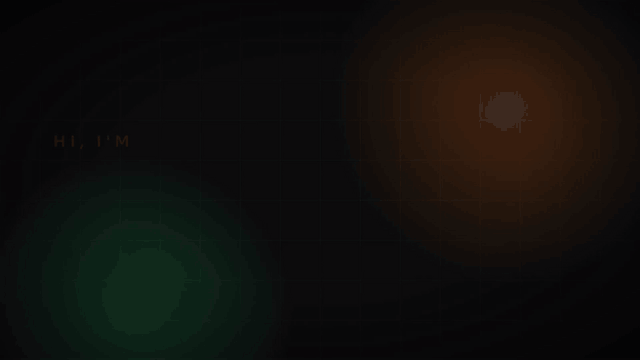

## About me

<a href="assets/about-me.mp4" title="Play the full About Me video">
  <picture>
    <source media="(prefers-reduced-motion: reduce)" srcset="assets/about-me-poster.jpg">
    
  </picture>
</a>

▶️ [Watch the full video (MP4, 15s, with player controls)](assets/about-me.mp4)

- 👋 Hi, I’m Max
- 👀 I’m interested in Art, Design & Tech
- 🌱 I’m currently learning Web Development
- 📫 maxnkosi28@gmail.com

<!---
maxnkosi/maxnkosi is a ✨ special ✨ repository because its `README.md` (this file) appears on your GitHub profile.
You can click the Preview link to take a look at your changes.
--->
